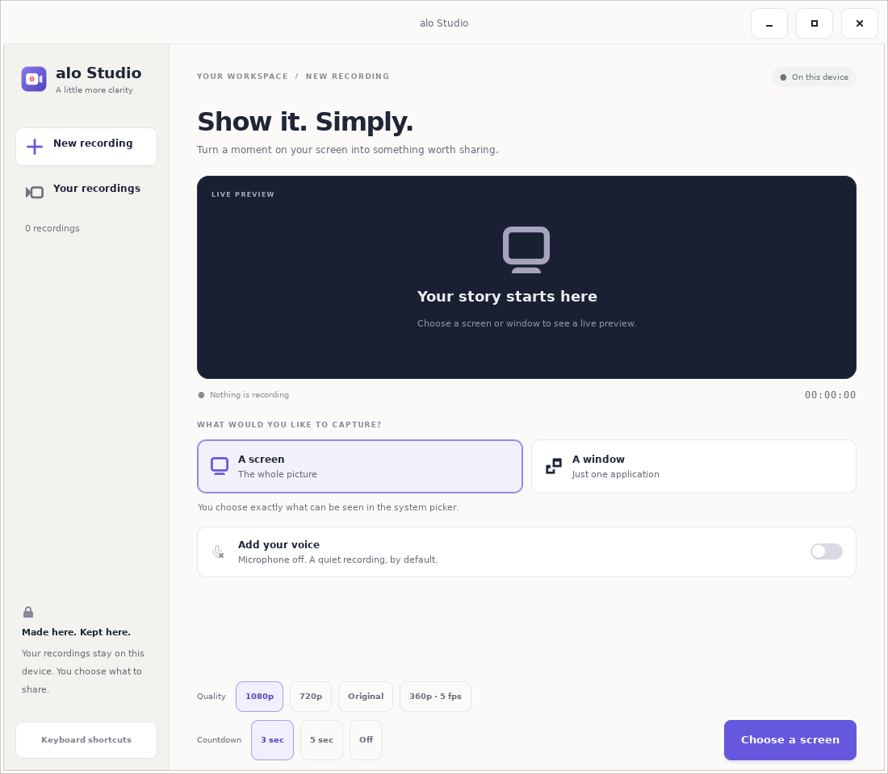

# alo Studio

A separate native application for recording a demo: pick a screen or window,
optionally add your microphone, record, pause, preview, and save a copy.

A short quality check warns if the chosen size may run slowly. You can choose
another size or explicitly record anyway; the app never changes it silently.
Recording preserves incoming frame timing, up to 30 frames per second. A slow
source does not generate duplicate frames just to reach that ceiling.
The explicit **360p · up to 5 fps** option reduces work on slower devices.
It also uses faster microphone encoding with the same 48 kHz mono audio and
96 kbit/s target bitrate. Other choices retain the standard audio encoder setting.
The quality check uses the selected size and frame rate; the default stays 1080p.
Quality and countdown options stay visible as direct choices. Alt + 1, Alt + 7,
Alt + O, and Alt + 3 select 1080p, 720p, original size, and 360p respectively.
If encoding falls behind or microphone samples are lost, Studio stops and saves
the captured portion with a clear explanation.
Preview and recording share one permission-scoped capture stream; starting the
encoder does not reconnect the selected source.
While the recording controls are open and the workspace is hidden, Studio skips
copying UI preview images so more processing time is available for recording.
Video starts after the microphone supplies its first timestamped sample, so a
slow microphone startup does not encode earlier preview frames. Bounded audio
buffers absorb short processing stalls. Audio queues are bounded by actual
buffer counts and bytes, so timestamp gaps do not masquerade as retained data.
Raw audio retains at most 200 buffers and encoded audio at most 500; each queue
also has a 1 MiB ceiling. Reaching any recording queue's limit requests a
controlled stop.
The controls show Starting while inputs open. The timer and Pause become active
after fresh video joins the chosen audio timeline; Stop remains available.

The microphone starts **off for every recording**. Videos stay on this device;
the application has no network permission. VP9 and Opus are encoded into WebM;
the lightweight profile uses VP8 and 16 kHz voice audio to reduce encoding cost,
following alo OS's encoding decision. Your original stays in the app's private
library even after you export a copy.
Saved duration is read from the completed media without blocking the UI.
Missing, damaged, or empty media is not reported as a completed recording.



## Install a built package

```sh
flatpak install --user ./alo-studio-0.1.0.flatpak
flatpak run org.aloworld.Studio
```

This branch adds alo OS's native screen/window picker and SaveFile frontend.
Capture follows the selected source's lifetime, and removing its permission
ends sharing. Export grants access to the exact chosen file through the
Documents portal. The integration report records which checks have passed and
the remaining booted-system acceptance work; implementing these services alone
does not establish that the complete recording flow works on an installed OS.
The live market entry remains separate until a signed application source serves
the package.

## Run from source

Requires Rust 1.97+, GTK 4.14+, GStreamer 1.22+, and the PipeWire, VP8, VP9, Opus,
PulseAudio and GTK media plugins. On Ubuntu:

```sh
sudo apt install libgtk-4-dev libgtk-4-media-gstreamer \
  libgstreamer1.0-dev libgstreamer-plugins-base1.0-dev \
  gstreamer1.0-plugins-good gstreamer1.0-plugins-bad \
  gstreamer1.0-pipewire gstreamer1.0-pulseaudio
cargo run --manifest-path apps/alo-studio/Cargo.toml
```

Screen selection requires a running `org.freedesktop.portal.ScreenCast`
service provided by the desktop. The app never replaces that permission with
unrestricted screen access. The system's picker may offer only the source
types supported by that desktop. Saving a copy uses the system file chooser.

## Application-market packaging

The desktop ID, Flatpak ID and AppStream ID are all `org.aloworld.Studio`.
`packaging/org.aloworld.Studio.json` is the source-build manifest. It has no
network permission, broad home-folder access, or camera permission. The audio
socket permits the optional microphone; the app opens it only when requested.

Use `packaging/build-flatpak.sh` to prepare vendored sources, build the Flatpak,
and export an installable bundle. A market publisher must publish this build to
a signed Flatpak remote before adding its identifier and source to alo OS's
catalogue. **It is not on Flathub merely because it has a manifest.**

## Agent control

The versioned [automation interface](docs/automation.md) provides semantic
recording actions and status for ask-alo and other agents. It shares the native
lifecycle and preserves the person's system source picker and export chooser.

## Checks

```sh
cargo fmt --manifest-path apps/alo-studio/Cargo.toml --check
cargo clippy --manifest-path apps/alo-studio/Cargo.toml --all-targets --features verification -- -D warnings
cargo test --manifest-path apps/alo-studio/Cargo.toml
```

The lifecycle and storage tests cover refusal paths, pause timing, microphone
reset, path traversal, empty recordings, and overwrite prevention. The optional
`verify-recording` example records a real X11 display through the production
encoder, pauses and resumes, finalizes the container, and decodes it to EOS.
The X11 diagnostic source is absent from ordinary installed builds.

`packaging/verify-pipewire.sh` additionally captures generated video over a
real, private PipeWire socket. It verifies attaching the recorder to the running
preview, pause/resume, finalization, and decoding, with and without generated
Opus audio. Hardware monitors are disabled in that isolated server; it does not
access the desktop or microphone.
The same fixture also checks `pulsesrc` against an isolated PulseAudio server and
virtual monitor, after allowing the preview to run. Decoded audio and video must
start within 250 ms. This check additionally needs `pipewire-pulse` and
`pulseaudio-utils`; it never selects a physical audio device.
With `ALO_STUDIO_CAPTURE_PROVIDER` and `ALO_STUDIO_CAPTURE_REMOTE`, the same
probe uses the native publisher and the actual restricted descriptor helper.
That integration fixture requires the full repository checkout for its shared
descriptor codec. It is excluded from the installed application. A diagnostic
`ALO_STUDIO_VERIFY_TIME_SCALE` between one and six extends observation in slow
OS guests; default CI timing and the minimum frame count remain unchanged.

`packaging/verify-native.sh` also drives the actual native UI through source
selection, quality preflight, countdown, pause/resume, completion, and a durable
library entry. It runs only a `verification` feature build on an isolated Xvfb
display. Synthetic sound exercises Opus without opening a physical microphone.
These checks run in `.github/workflows/studio.yml`; they do not prove the
Wayland permission picker works on alo OS or replace a physical-machine walk.

The separate `verify-portal` example exercises the production ScreenCast and
PipeWire path on an explicitly selected desktop. It is not the Xvfb fixture.
Build it with `--features verification --example verify-portal`, then run it
with an output `.webm` path and optional `screen` or `window` argument from
that desktop's own session. It saves a preview image and requires at least
15 captured frames and a finalized video that decodes to completion. The
bounded `ALO_STUDIO_VERIFY_TIME_SCALE` also applies to this probe. The real
screen portal passed in a booted alo OS guest; the integration report records
the separate application, microphone, and permission-revocation observations.

User-facing copy goes through the gettext domain `alo-studio`. Translators can
provide standard gettext catalogues without changing the recording code.
